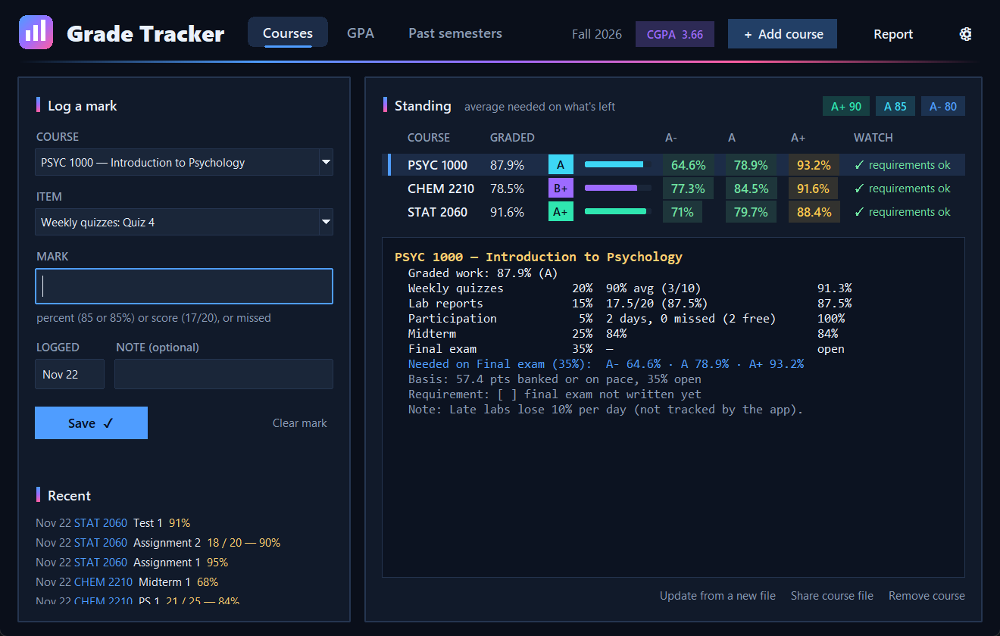
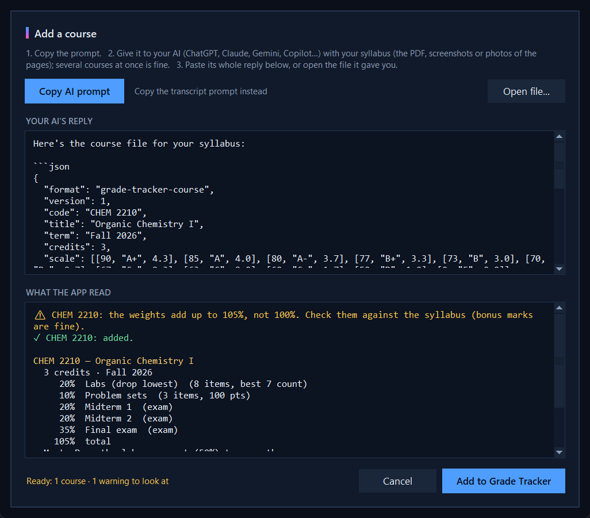
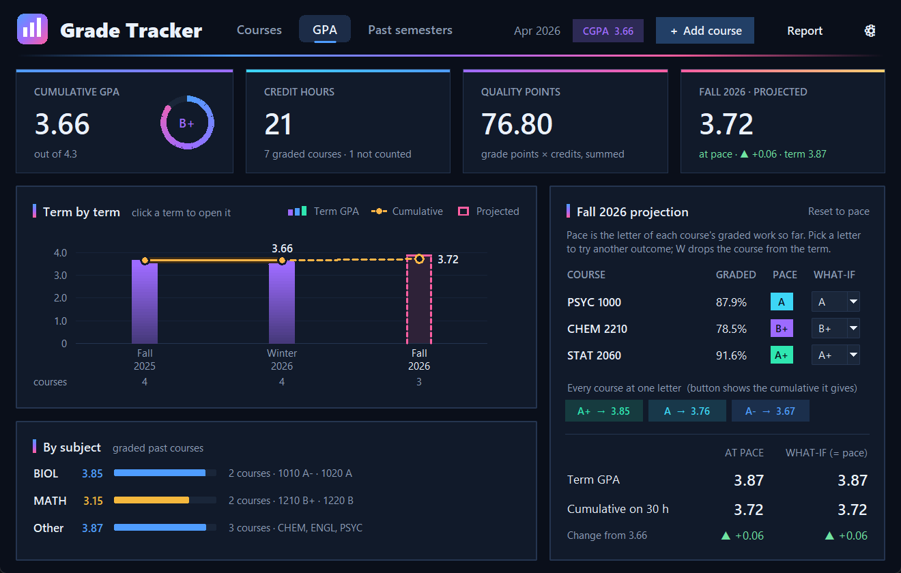

<p align="center"></p>

<h1 align="center">Grade Tracker</h1>

<p align="center">Turn your syllabus into a tracker that tells you exactly what you need on the rest of the term.</p>

<p align="center"><a href="../../releases/latest"><b>Download for Windows</b></a></p>



## How it works

You don't type in your syllabus. Your own AI reads it for you:

1. **Copy the prompt.** Click **Add course → Copy AI prompt**.
2. **Give it to your AI with your syllabus.** Paste the prompt into ChatGPT, Claude, Gemini or Copilot and attach your syllabus: the PDF, screenshots, or photos of the pages. Several courses at once is fine.
3. **Paste the reply back.** Grade Tracker checks it and shows you what it read: every component, weight and rule, plus any warnings such as weights that don't add up to 100%. Compare it with your syllabus, then click **Add**.

Then log marks as they come back. For every course you see:

- your average on graded work so far, as a percent and a letter;
- **the average you need on everything that's left** for each letter (e.g. A-, A, A+), or "locked in" / "out of reach";
- pass requirements ("50% on the final or you fail") and whether you're meeting them.



## What it understands

The math follows the rules syllabi actually use:

- best *N* of *M* (drop the lowest quizzes), points-weighted work, items with their own weights
- point pools with a cap ("earn any 30 points from the 10 activities")
- attendance and participation with free misses
- "the higher of your midterm or final" components
- the final replacing your lowest test, and exemptions for a high test average
- pass requirements on a component or on an average of components, and minimums that cost marks when missed

Coursework in progress is projected at its current level. The exams still to come are solved for the single average that gets you each letter.

## GPA and past semesters



Import your unofficial transcript the same way: **Past semesters → Import transcript…**, copy the transcript prompt, and give it to your AI with the transcript. The app recalculates every term GPA and your cumulative GPA from the letters, and warns you if a figure doesn't match the transcript, which catches a misread letter. The **GPA** tab then projects this term: every course at its current pace, or any letter you pick ("what if I get a B+ in Chem?"). **W** drops a course from the term.

## Also

- **Report** saves a printable page with every course, your GPA and past terms. Open it in your browser to print it or save it as a PDF.
- **Share course file** saves a course without your marks, so classmates can add the same course without asking their AI.
- **Update from a new file**: if the AI got something wrong, fix it (or ask the AI to) and add the course again. Your marks carry over.
- **Settings**: the term's name, which letters to show columns for, and your school's letter scale and grade points.

## Your data

Everything stays on your computer, in `%APPDATA%\Grade Tracker` (**Settings → Open data folder**). The app never connects to the internet. The only thing that leaves your computer is what *you* give your own AI: your syllabus or transcript.

## Download and run

Download `GradeTracker.exe` from the [latest release](../../releases/latest) and run it. There's nothing to install.

Windows may say *"Windows protected your PC"* the first time, because the app isn't code-signed. Click **More info → Run anyway**. The `.exe` is built from this repository by GitHub Actions ([workflow](.github/workflows/build.yml)), so you can check exactly what's in it.

### From source

Needs Python 3.9 or newer (with tkinter, included in the python.org installer). It uses the standard library only.

```
git clone https://github.com/2048Israel/grade-tracker
cd grade-tracker
python -m gradetracker
```

### Command line

The same features work from a terminal, for scripts or AI agents:

```
python -m gradetracker prompt > prompt.md             # the text to give your AI
python -m gradetracker check reply.json               # check the AI's file without saving
python -m gradetracker import reply.json              # add the course(s) or transcript
python -m gradetracker add "BIOL 1010" "Lab 3" 17/20  # marks: 85, 85%, 17/20, points, missed, present
python -m gradetracker status                         # standing and needs, every course
python -m gradetracker gpa --what-if B+ "BIOL 1010=A-"
python -m gradetracker report grades.html
```

`GradeTracker.exe` takes the same commands. Add `--data FOLDER` to use another data folder.

## The file format

The prompts are the format's specification: [syllabus prompt](gradetracker/data/syllabus-prompt.md), [transcript prompt](gradetracker/data/transcript-prompt.md). There are worked examples in [example-course.json](gradetracker/data/example-course.json) and [example-transcript.json](gradetracker/data/example-transcript.json). The tests import every example in the prompts, so the prompts and the app can't drift apart.

## Building

```
python -m pip install -r packaging/requirements-build.txt
powershell -ExecutionPolicy Bypass -File packaging/build.ps1     # tests, then dist\GradeTracker.exe
python -m unittest discover -s tests                            # tests only
```

Pushing a tag like `v0.2.0` builds the `.exe` and publishes it as a release.

## License

[MIT](LICENSE)
